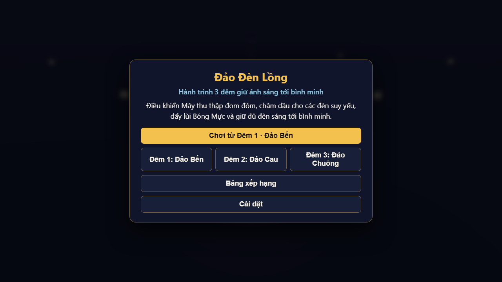
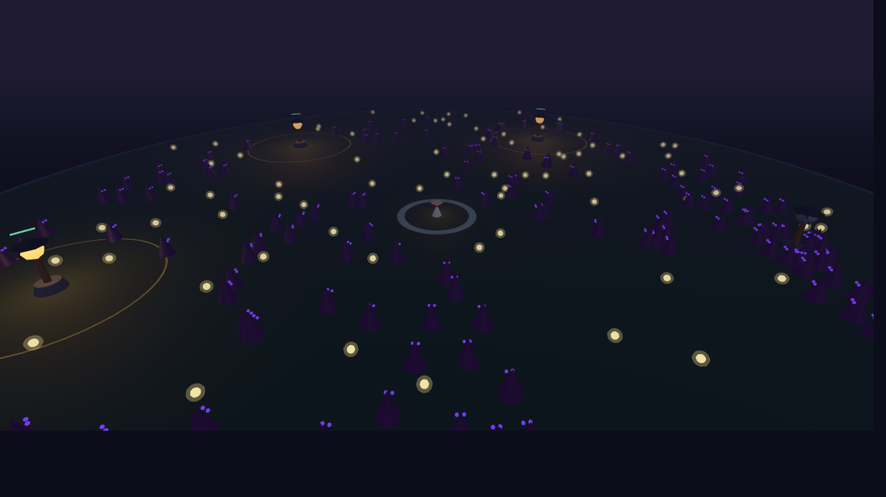

# Đảo Đèn Lồng — `v1.0.0` (Phase 4 · "Bình minh")

> **Trạng thái phát hành:** **`v1.0.0` (`TICKET-04` · `Test Contract v1.3` · Tag `phase-4`)** — Game 3D WebGL (Three.js) kèm lõi mô phỏng tất định 60 Hz thuần TypeScript, chiến dịch 3 Đêm (`Đảo Bến`, `Đảo Cau`, `Đảo Chuông`), hệ thống nhiên liệu đèn & Bóng Mực hút dầu (`drain`), Bảng xếp hạng cục bộ, Trợ năng đầy đủ (`>= 18px`, chữ lớn `×1.25`, đổi phím, phụ đề + mũi tên, giảm chuyển động, mù màu), Benchmark `1280×720` và Soak test `10` Đêm.




---

## Cài đặt & Chạy game 3D (3 lệnh)

Yêu cầu: **Node.js `^20.19.0 || >=22.12.0`** (theo yêu cầu Vite 8; bản CLI `dist-cli/` chạy từ Node 18; hoạt động đồng nhất trên macOS, Linux và Windows).

```bash
npm install
npm run build
node dist-cli/cli/run.js
```

*(Hoặc chạy tĩnh bằng `npm run preview`; `node dist-cli/cli/run.js` kiêm server tĩnh + lưu Bảng xếp hạng cục bộ tại `~/.dao-den-long/leaderboard.json` và tự mở trình duyệt.)*

---

## Mô tả 3 Đêm & Luật chơi (`Contract v1.3`)

1. **Đêm 1 — Đảo Bến (`240s`, 5 đèn `L1..L5`, cần `≥ 3` đèn lúc bình minh):** Đảo tròn bán kính `40m`, làm quen nhịp nhặt đom đóm, châm dầu và xua Bóng Mực khỏi đèn yếu.
2. **Đêm 2 — Đảo Cau (`270s`, 6 đèn `L1..L6`, cần `≥ 4` đèn lúc bình minh):** Hai hòn đảo nối bằng cầu tre và 2 bục nhảy gió; xuất hiện **Bùa Gió (`C1`)** và **Gió Lạc (Drifter)**.
3. **Đêm 3 — Đảo Chuông (`300s`, 7 đèn `L1..L7`, cần `≥ 5` đèn lúc bình minh):** Địa hình 3 tầng (`Y=0 / 3 / 6`), 2 dốc nối, bục nhảy lên **Tháp Chuông**, Bóng Mực `4.5 m/s`, 2 **Bùa Gió (`C1, C2`)**, và chu kỳ **gió mạnh** mỗi `30s` (báo trước `2s`).

- **Nhiên liệu đèn & Sức chứa (`10 → 20`):** Thắp mới tốn `10` đom đóm (`fuel = 100`, tự hao `1/s`), châm dầu khi đang sáng theo `used = min(carried, ceil((100 - fuel) / 10))`. Đèn có `fuel < 30` mất vùng an toàn `6m` và thu hút Bóng Mực `wander` hút `drain` (`-5/s`); tắt khi về `0` và thắp lại chỉ tốn `5`. Mỗi đèn tự thắp thành công tăng sức chứa `+2` (tối đa `20`).
- **Thắng / Thua:** Sống sót tới bình minh (`time_left_s = 0, flames > 0`) và giữ sáng `≥ ceil(0.6 × tổng đèn)` → **`dawn_survived`**. Hết Ngọn Lửa (`no_flames`) hoặc bình minh thiếu đèn (`dawn`) → thua.

---

## Điều khiển & Trợ năng (Cỡ chữ tối thiểu `18px` ở `1280×720`)

| Thao tác | Phím mặc định (Đổi được trong Cài đặt) |
|---|---|
| Di chuyển (gồm điều khiển trên không) | `W A S D` (hoặc phím mũi tên) |
| Xoay góc nhìn thứ ba | Kéo chuột trái (độ nhạy tùy chỉnh) |
| Nhảy (`7.0 m/s`) / Lướt (`14 m/s`) | `Space` / `Shift` (hoặc chuột phải) |
| Nạp đom đóm / Châm dầu | `E` |
| Tỏa sáng (`3` đom đóm, bán kính 3D `5m`) | `R` (hoặc `F`) |
| Tạm dừng / Tắt mở âm thanh nhanh | `Esc` (hoặc `P`) / `M` |

- **Trợ năng:** Đổi phím cho cả 9 hành động kèm báo trùng phím & **"Khôi phục mặc định"**; phụ đề hình ảnh + mũi tên mép màn hình chỉ hướng Bóng Mực khi xuất hiện; **"Giảm chuyển động"**; **"Bảng màu dễ phân biệt"** (`#00B3FF` + `#FFFFFF ⚠`); **"Chữ lớn (×1.25)"**.

---

## Kiểm thử, Headless, Benchmark, Soak & Xuất Bảng xếp hạng

- **Test Suite (`59` subtests):**
  ```bash
  npm test
  ```
- **Chế độ Headless (`60 Hz`, Contract `v1.3`):**
  ```bash
  node dist-cli/cli/headless.js --seed 7 --night 1 --ticks 60 --out n1.jsonl
  node dist-cli/cli/headless.js --seed 7 --night 2 --ticks 60 --out n2.jsonl
  node dist-cli/cli/headless.js --seed 7 --night 3 --ticks 60 --out n3.jsonl
  ```
- **Benchmark WebGL `1280×720` (`--disable-gpu-vsync --disable-frame-rate-limit`):**
  ```bash
  node dist-cli/cli/bench.js --seed 42 --duration 30 --out bench.json
  ```
  *(Chú thích `bench.json`: `vsync_off: true` bật qua cờ trình duyệt Chromium/Edge; `peak_mem_mb` ghi `null` vì trình duyệt sandbox tách riêng tiến trình GPU/renderer khỏi RSS của Node theo đúng quy ước bản web trong Contract `v1.3`.)*
- **Soak test `10` Đêm liên tiếp:**
  ```bash
  node dist-cli/cli/soak.js --seed 7 --nights 10 --out soak.json
  ```
- **Xuất Bảng xếp hạng Top 10 ra JSON:**
  ```bash
  node dist-cli/cli/run.js --export-leaderboard out.json
  ```

---

## Tài liệu & Ghi chép dự án

| Tài liệu | Nội dung |
|---|---|
| [CHANGELOG.md](CHANGELOG.md) · [ADR-001](docs/notes/adr-001-lantern-fuel-and-win-condition.md) | Chi tiết thay đổi qua 4 phase & quyết định kiến trúc |
| [CREDITS.md](CREDITS.md) · [LICENSE](LICENSE) | Nguồn asset procedural, thư viện, AI & giấy phép MIT |
| [docs/notes/retro.md](docs/notes/retro.md) | Retrospective tổng kết 4 phase & chiến lược token |
| [docs/notes/assumptions.md](docs/notes/assumptions.md) · [docs/notes/ai-log.md](docs/notes/ai-log.md) | Giả định `P1..P4` & nhật ký sử dụng AI |
| [docs/proof/phase-0/README.md](docs/proof/phase-0/README.md) · [phase-1](docs/proof/phase-1/README.md) · [phase-2](docs/proof/phase-2/README.md) · [phase-3](docs/proof/phase-3/README.md) · [phase-4](docs/proof/phase-4/README.md) | Bằng chứng kiểm chứng từng phase |
| [bench.json](bench.json) · [soak.json](soak.json) | Kết quả benchmark & soak test thực tế trên máy dev |
| [AGENTS.md](AGENTS.md) · [.agents/skills/verify-phase/SKILL.md](.agents/skills/verify-phase/SKILL.md) | AI harness sử dụng trong repo |
